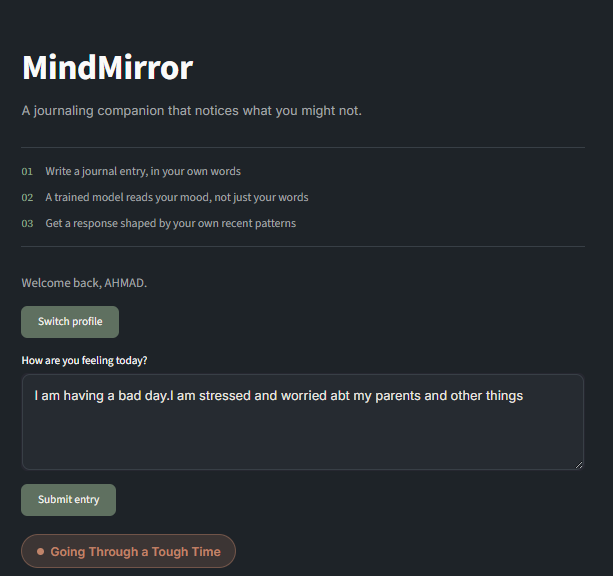
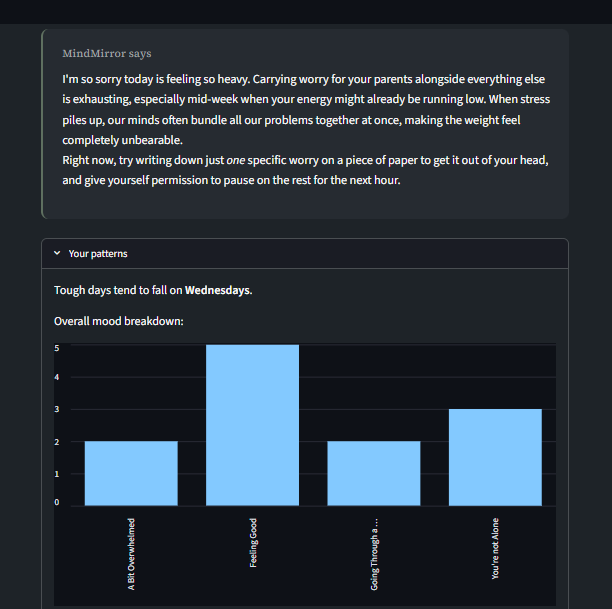
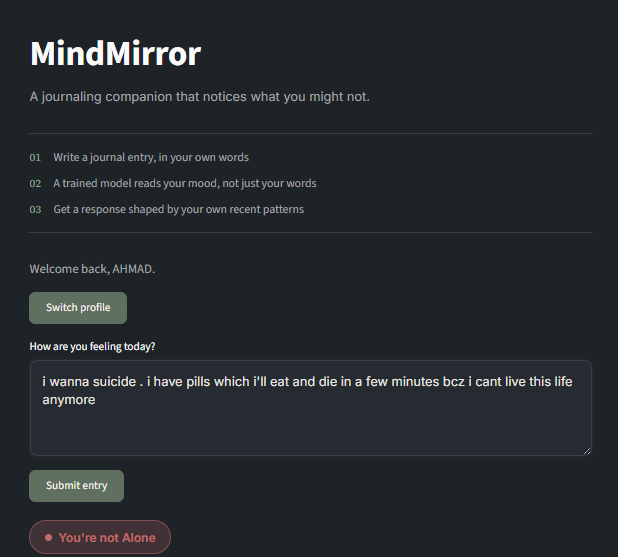
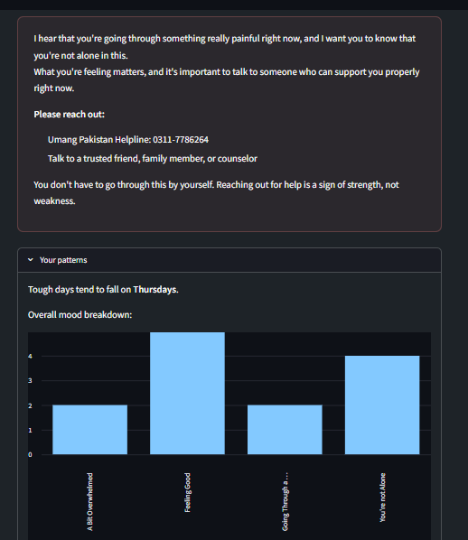

# MindMirror

An AI journaling companion that learns your mood patterns and responds with gentle, CBT-inspired support — built for [Hackathon Name] 2026.

## The problem

Most mental wellness apps either ask you to log a mood on a 1-5 scale, or they're a generic chatbot that responds the same way no matter what you've written before. Neither approach really helps you notice your own patterns — the kind of thing a good journal (or a good friend) would pick up on over time.

We wanted to build something in between: a journal that actually pays attention. Something that notices if your mood tends to dip on certain days, tracks whether things are getting better or worse over the past week, and uses that context when it responds to you — instead of just reacting to today's entry in isolation.

## What MindMirror does

You write a journal entry like you normally would. Behind the scenes:

1. The entry is analyzed to determine your mood, using a combination of a machine learning model we trained ourselves and sentiment analysis (more on why below).
2. That entry, along with the detected mood, gets saved to your personal history.
3. We look back at your recent entries to find patterns — which day of the week tends to be hardest for you, whether your mood has been trending up or down over the last week, and so on.
4. An AI agent (built with LangChain and Gemini) takes your entry, the detected mood, and those patterns, and responds — not with generic advice, but with something that references what it's actually noticed about you.

If the entry looks like it could reflect a genuine crisis, the AI agent step is skipped entirely, and you get a fixed, pre-written response with helpline information instead. More on why below.

## Why the mood categories aren't clinical labels

The dataset we trained on originally had labels like Depression, Bipolar, Anxiety, and Suicidal — pulled from Reddit and Twitter posts. We made a deliberate decision not to show any of that to users.

A text classifier trained on scraped social media posts is not a diagnostic tool, and telling someone "you have depression" based on one journal entry would be irresponsible — even setting aside that the underlying labels were self-reported and never clinically verified in the first place.

So instead, we mapped the seven original categories down to four non-clinical, plain-language ones:

- **Feeling Good**
- **A Bit Overwhelmed**
- **Going Through a Tough Time**
- **You're not Alone** (our internal label for what used to be "Suicidal" — chosen specifically to be supportive rather than alarming)

## How mood detection actually works

This went through more iteration than anything else in the project, so it's worth explaining honestly.

We started by training a Logistic Regression classifier on TF-IDF text features (we also tried Random Forest, SVM, and Naive Bayes, but Logistic Regression gave the best results). We handled the dataset's class imbalance with weighted training, and gave extra weight to the crisis category specifically, since a missed crisis case is a far worse outcome than a false alarm.

Once we started testing with real, casually-written sentences instead of dataset-style text, we ran into a real problem: a model built purely on TF-IDF is sensitive to exact wording. Two sentences with the same meaning — "everyone hates me" versus "every person hates me" — could get classified completely differently, because TF-IDF matches specific word patterns rather than meaning. For an app dealing with something this sensitive, that kind of inconsistency wasn't acceptable.

So we moved to a **hybrid approach**: VADER (an established, general-purpose sentiment analysis tool) determines how severe the sentiment of an entry is, and that severity places the entry into one of a few tiers:

- Explicit crisis language (e.g. mentions of self-harm or suicide) is always treated as the crisis category, regardless of anything else.
- Very strongly negative sentiment, without explicit crisis language, is treated as serious distress.
- Moderately negative sentiment is where our trained model actually gets used — it decides between two adjacent, less-severe categories, since this is the range where the model's training on mental-health-specific language adds real value.
- Mild or ambiguous sentiment is also handed to the model, since VADER isn't confident enough on its own here.
- Clearly positive sentiment is treated as "Feeling Good."

In short: VADER decides *how severe* something is, and our custom model helps decide the finer distinction *within* a severity range, rather than the model making every decision alone. We made this choice on purpose. A pure ML classifier looked more impressive in isolation, but it also occasionally behaved unpredictably on real phrasing during testing — and for something safety-adjacent, predictable and explainable mattered more to us than showcasing the model working end-to-end by itself.

## Why the AI agent doesn't respond to crisis entries directly

For anything classified as "You're not Alone," we deliberately skip AI generation entirely. Instead, the user sees a fixed, pre-written message with a helpline number and encouragement to reach out to someone. A generative model's response in a genuinely high-risk moment is unpredictable, and that's not a risk worth taking. For every other mood category, the AI agent generates a short, CBT-inspired, non-diagnostic response that references the user's recent patterns when relevant.

## Screenshots

**A normal entry** — the model detects a moderate, everyday kind of stress, and the response references the pattern data (day of week, mood breakdown) alongside the entry itself.




**A crisis entry** — AI generation is skipped entirely, and a fixed, reliable response with helpline information is shown instead.




## Tech stack

- **Python** — core language
- **Scikit-learn** — TF-IDF vectorization, Logistic Regression model
- **VADER Sentiment** — the primary severity signal in our tiered detection approach
- **MySQL** — storing users and journal entries
- **LangChain + Google Gemini** — the conversational agent
- **Streamlit** — the web interface
- **Pandas / NumPy** — data cleaning and pattern analysis

## Known limitations

We're being upfront about these rather than hiding them:

- **The model leans toward over-flagging distress rather than under-flagging it**, by design. We'd rather show a slightly-too-cautious response than miss something serious.
- **Pattern insights need at least a few journal entries to be meaningful.** For a brand-new user, the app is upfront about this — it shows a "not enough data yet, keep journaling" message rather than guessing.
- **Demo data:** since meaningful pattern detection needs history built up over days or weeks, we pre-seeded a few demo profiles with two weeks of sample journal entries so the pattern-detection features can be shown without waiting. In real use, this data builds up naturally as someone journals.
- **Authentication is simplified.** There's no password-based login — profiles are selected or created by name. This was a deliberate scope decision, not an oversight.

## Running it locally
This project isn't deployed publicly, since it relies on a MySQL database running locally. To try it out, run it on your own machine:

1. Clone the repo and create a virtual environment.
2. `pip install -r requirements.txt`
3. Set up a MySQL database and create a `.env` file with your credentials and a Google Gemini API key:
   ```
   DB_HOST=localhost
   DB_USER=root
   DB_PASSWORD=
   DB_NAME=mindmirror_db
   GOOGLE_API_KEY=your_key_here
   ```
4. Run `python model/train_model.py` once to train and save the model (or use the pre-trained `.pkl` files already included in the repo).
5. Run `streamlit run app.py`
